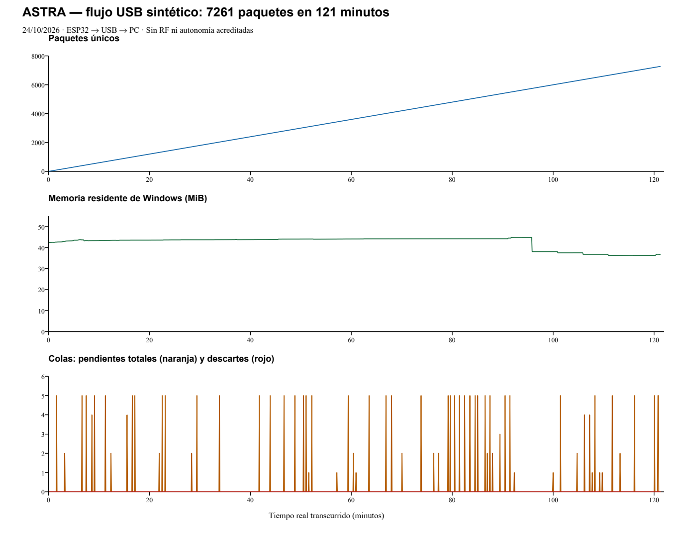

# 24/10/2026 — ACTUALIZACIÓN 09: aceptación del banco USB y cierre de la campaña prolongada

Diarios: [ASTRA-20](https://astrateam2026.atlassian.net/browse/ASTRA-20), [ASTRA-21](https://astrateam2026.atlassian.net/browse/ASTRA-21), [ASTRA-22](https://astrateam2026.atlassian.net/browse/ASTRA-22) y [ASTRA-34](https://astrateam2026.atlassian.net/browse/ASTRA-34). Continúo las actualizaciones [07, intento interrumpido y corrección](2026-10-24-medidor-y-reinicio-prolongado-actualizacion-07.md) y [08, recuperador](2026-10-24-recuperacion-conflicto-interno-actualizacion-08.md). Conservo toda la historia y las pruebas anteriores.

## Resultado medido

Completé el segundo intento por USB físico con el ESP32 y la GUI. La primera muestra llegó el 24/10 a las 01:09:02,751 ART y la última a las 03:10:03,084 ART. El reloj monotónico mide 7260,328 s entre ambas: 2 h 1 min 0,328 s reales, sin acelerar el emisor. El programa cerró a las 03:10:21 ART y liberó la inhibición transitoria de suspensión, sin cambiar ajustes persistentes.

| Control | Resultado |
|---|---|
| Contadores esperados y recibidos | 1..7261, 7261 únicos; sin huecos, duplicados o conflictos |
| CSV | 7261 filas, iguales a los paquetes del diario y encabezado de 22 campos |
| Diario bruto | 33234 eventos conservados, sin errores de lectura |
| Escritores al cerrar | Cero pendientes, descartes y errores, tanto raw como CSV |
| Colas observadas | Máximo conjunto de 5 eventos pendientes, frente a capacidad de 600 por escritor |
| Encuadre/transporte durante el segmento nominal | Cero rechazos, desbordes, errores de fuente o desconexiones |
| Cadencia de llegada | Media 1,000045 s; mediana 1,015 s; mínimo 0,937 s; máximo 1,063 s |
| Progreso de GUI durante el flujo | 1407 observaciones; mayor intervalo entre controles 5,266 s |
| Contenedores observados | Historial máximo 300 muestras; cola de pantalla máxima 1, con límite 250 |
| Memoria residente del proceso en Windows | Mínimo 36,26 MiB; máximo 44,86 MiB; inicial 42,43 MiB; final 36,77 MiB |
| Medidor de memoria | Una sola inicialización en cada control registrado |
| Aceptación automática | Todas las comprobaciones pasaron |

No uso la mediana para calcular deriva acumulada: la separación primera/última equivale a 7260 intervalos. El desfase de llegada acumulado respecto de 7260 s es aproximadamente 0,328 s en esta corrida; no es precisión de reloj certificada ni latencia RF. La marca UTC difiere unos milisegundos de la monotónica; conservo ambas.

La memoria es working set del proceso, no todo el heap ni una demostración universal de ausencia de fugas. Conservo sus subidas y bajadas sin atribuirles una causa que no medí. Los límites explícitos de contenedores y la prueba específica del medidor respaldan el alcance observado; no prometo duración ilimitada ni conservación ilimitada si fallan todos los destinos.

## GUI, reconstrucción y fuentes

Observé de nuevo la GUI después de dos horas, con contador 7247, los 22 campos y seis gráficas legibles, origen USB_BENCH y datos sintéticos identificados. La herramienta mostró las imágenes dentro del chat. El intento de exportarlas como PNG no entregó el formato esperado: no afirmo que exista un archivo adicional de captura de GUI. Volví al chat y cerré el control de pantalla; la corrida cerró automáticamente después de completar las 7261 muestras.

Reconstruí posteriormente desde el diario y su CSV con la versión nueva del recuperador: 7261 candidatos, cero conflictos o errores y originales sin cambios. El CSV reconstruido tiene la misma SHA256 que el adquirido: `f62404025543b6391957352b5de0c081f91557d6c41f6d1e6fd83643f243e1c2`.

La adquisición ejecutó el snapshot de la actualización 07, correspondiente al código publicado en `ce3220891ece63d2fcaa0c7990ec8d3eaa63181f`. Verifiqué que app, motor, escritores, transporte, modelo, encuadre y firmware conservan sus huellas. El recuperador offline posterior tiene su propia huella y prueba; no lo atribuyo al proceso que adquirió los datos. La suite actual pasó 18 pruebas de software.

[Resultado original del analizador](../evidence/2026-10-24-banco02/usb-prolongado-13/resultado-original.json) · [CSV conservado sin cambios](../evidence/2026-10-24-banco02/usb-prolongado-13/Flight_1000.csv) · [Serie completa de salud](../evidence/2026-10-24-banco02/usb-prolongado-13/health.csv) · [Verificación, reconstrucción y liberación de suspensión](../evidence/2026-10-24-banco02/usb-prolongado-13/verificacion-y-recuperacion.json) · [Manifiesto del snapshot](../evidence/2026-10-24-banco02/usb-prolongado-13/source-manifest.json).

El diario original queda privado y conserva la huella publicada en el resultado. No publico rutas personales o la procedencia completa del recuperador, que contiene rutas locales. Los archivos CSV y de salud publicados son sintéticos. Esta gráfica se genera a partir de health.csv; el panel de memoria muestra el proceso medido mediante la API de Windows, y las colas son observaciones periódicas, no un registro continuo de cada instante.

## Estado de la etapa completa

| Bloque del plan | Implementado y verificado | Límite o pendiente |
|---|---|---|
| Adquisición/archivo independientes | Colas por destino y formato, estados separados, fallos y capacidad agotada probados en software; corrida nominal prolongada sin descartes | Cortes eléctricos y fallo físico de soporte no acreditados; detalle de pérdidas acotado y truncamiento explícito |
| Reinicios/reconexiones/sesiones | RST y desconexión/reconexión físicos con segmentos preservados; ambigüedad sin inventar continuidad | La ráfaga malformada de reconexión conserva causa desconocida; no hubo emisión de una nueva misión durante aquella desconexión |
| Firmware configurable | Cinco escenarios por USB y nuevas identidades de ejecución; perfil ilustrativo 15/5 m/s con transición al 80 % | Los cinco casos físicos iniciales, la corrección de cadencia y esta corrida tienen versiones y evidencias distintas, identificadas en el diario |
| Banco bidireccional | RUN/STOP, cero, hora y alimentación sintéticos, estados de orden, duplicados físicos; tardíos/timeout/resultado desconocido en software | No es protocolo de vuelo aprobado; deduplicación de banco tiene memoria y contexto limitados |
| Calidad/reproducción | Origen, edades, GPS retenido o ausente, conflictos, reloj congelado, giro SI con original conservado, reproducción nueva | La validez GPS es la del perfil de banco; no valida un sensor físico |
| Recuperación | Igualdad de reconstrucción prolongada, dos soportes con huellas iguales y bloqueo de conflictos entre copias o dentro del diario | Un CSV no revela marcas que sólo quedaron en un diario ausente; no se rellenan pérdidas |
| Interfaces/antenas/enlace | Propuesta para revisar con Edu, dos antenas y presupuesto preliminar; revisión de potencia/airtime | Variante/pinout TBR y Radio Profile/ICD sin aprobar; no RF configurada |
| Antecedentes | Tabla evidencia→riesgo→prueba→resultado, tierra/verificación de ITBA/Daedalus y criterios generales del premio Mark Walker | No auditoría mundial completa ni puntajes técnicos del ganador DJS; rotor separado |

La prueba prolongada contiene una misión sintética inicial y 7144 muestras LANDED para sostener el flujo. No representa un vuelo de dos horas ni una trayectoria física completa durante todo ese tiempo. Los datos GPS posteriores siguen siendo ilustrativos; no demuestran movimiento real en recuperación.

Referencias de los otros bloques: [cinco escenarios y arquitectura](2026-10-23-banco02-actualizacion-01.md), [RST](2026-10-23-rst-fisico-actualizacion-03.md), [reconexión y dos soportes](2026-10-24-reconexion-y-doble-soporte-actualizacion-04.md), [cadencia e identidad](2026-10-24-cadencia-identidad-e-inicio-prolongado-actualizacion-05.md), [GPS](2026-10-24-gps-presentacion-actualizacion-06.md), [interfaz para Edu](interfaces/2026-10-23-propuesta-banco-y-vuelo.md), [antenas](interfaces/2026-10-23-antenas-y-link-budget-preliminar.md), [potencia/airtime](interfaces/2026-10-24-radio-potencia-y-airtime-actualizacion-03.md) y [antecedentes](investigacion/2026-10-23-antecedentes-a-pruebas.md).

## Procedimiento reproducible

El ESP32 debe tener el firmware de banco identificado y el puerto libre. Confirmo su puerto; COM5 es el de este ensayo. Si quedó una simulación activa, primero envío STOP y compruebo ejecución antes de calibrar/iniciar otra. No deduzco el modo de la placa por la luz. Uso Python 3.12 con Tk y pyserial 3.5.

Para repetir la misma configuración con fuente congelada, creo una carpeta de ensayo nueva, exporto con `git archive` las carpetas `ground-station/banco-usb-v0.1` y `ground-station/banco-usb-v0.2` del commit `ce3220891ece63d2fcaa0c7990ec8d3eaa63181f` y extraigo su árbol dentro de `source/`. Copio el [lanzador exacto utilizado](../evidence/2026-10-24-banco02/usb-prolongado-13/run_soak.py) al directorio del ensayo y lo ejecuto con ese Python. El lanzador busca `source/ground-station/banco-usb-v0.2/app.py`, genera `output/`, solicita 7261 muestras por COM5, cierra después de 7280 s e inhibe temporalmente la suspensión por inactividad con liberación al salir. Si cambia el puerto o una entrada, conservo una copia nueva y registro esa diferencia; no edito este original de evidencia.

Después del cierre uso el [analizador](../tools/resumir_usb_prolongado.py) con `--expected 7261 --minimum-seconds 7200` y una salida nueva. Para la reconstrucción uso el recuperador actual sobre el diario y CSV originales y otra salida nueva; comparo huellas. No paso una entrada como salida ni reemplazo una reconstrucción previa. El [README del banco](../banco-usb-v0.2/README.md) conserva las órdenes de ejecución y escenarios cortos.

## Qué puedo afirmar en el PDR

Puedo presentar un banco de tierra que distingue recepción, validación y guardado, conserva contextos y evidencia, detecta los fallos ensayados y permite reconstrucción trazable con bloqueo de contradicciones. Tengo cinco escenarios físicos iniciales, RST/reconexión físicos, reproducción en dos discos y ahora más de dos horas reales de USB con GUI y registros verificables. Es una mejora propia demostrada de manejo de datos; su valoración como innovación del concurso no está resuelta.

No afirmo RF, interoperabilidad STM32, autonomía, persistencia ante corte eléctrico o cumplimiento integral CONAE. La identificación definitiva, los parámetros compartidos y los telecomandos de vuelo requieren acuerdo con Edu. La prueba de dos soportes usó C: y un almacenamiento USB en otro disco; no confirmé si era microSD o pendrive. La recepción física con respaldo externo simultáneo sigue pendiente de conectividad suficiente. La legibilidad al sol sigue pendiente. La validación del banco no garantiza detectar toda alteración numérica silenciosa ni sustituye el CRC/contrato de vuelo.

Mantengo abiertas las tareas cuyos criterios dependen de esos puntos externos. No cierro el proyecto completo por cerrar la aceptación de este banco USB.
