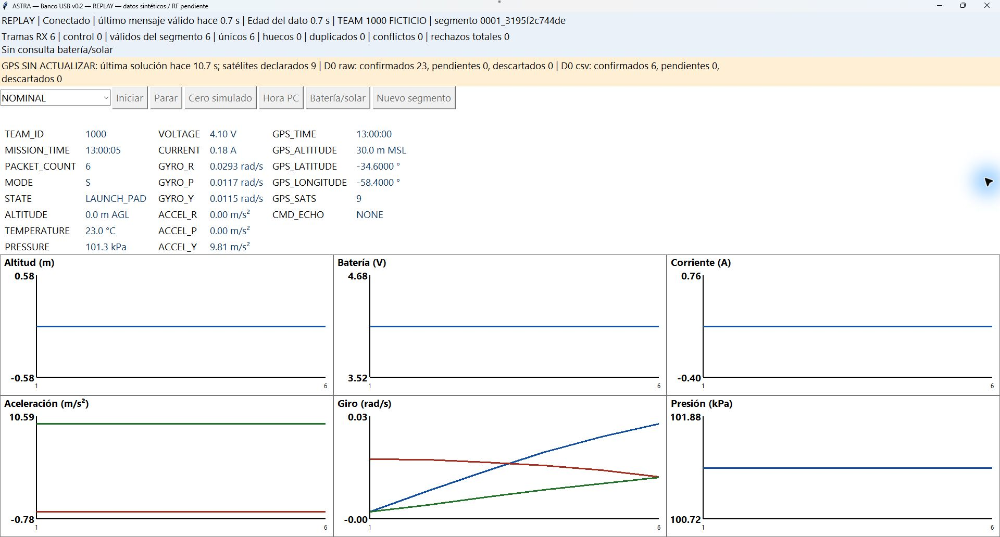

# 24/10/2026 — Calidad de datos: comparación medida y cierre de la investigación

Diario: [ASTRA-34](https://astrateam2026.atlassian.net/browse/ASTRA-34). Implementación y uso: [ASTRA-21](https://astrateam2026.atlassian.net/browse/ASTRA-21) y [ASTRA-22](https://astrateam2026.atlassian.net/browse/ASTRA-22). Actualizo el [sondeo original](2026-10-19-innovacion-y-prevencion.md), sin modificarlo.

## Problema que pude resolver

Una trama válida y nueve satélites declarados no garantizan que la solución GPS se actualice. El motor ya conservaba su edad, pero la GUI anterior sólo advertía ausencia de fix, reloj de misión congelado o antigüedad general. Agregué un aviso GPS específico cuando siguen llegando mediciones frescas y la última solución GPS supera su edad permitida. Si falta toda la telemetría, informo esa antigüedad sin culpar además al GPS.

Separé reglas de calidad de la presentación en quality.py. El motor admite un reloj explícito para ensayos deterministas; en operación sigue usando el reloj monotónico de la PC. Los umbrales de antigüedad son configurables con --data-stale-seconds y --gps-stale-seconds. Tres segundos es el valor del banco, no una decisión de vuelo. Conservo mensajes y CSV originales; no elimino ni sustituyo mediciones por una alarma.

## Comparación y medición

Ejecuté seis trazas elegidas con muestras de un segundo y evaluación cada 0,25 s. La referencia anterior reproduce las reglas documentadas de la GUI previa; no ejecuta una GUI histórica ni se presenta como comparación de confiabilidad en campo.

| Caso | Regla anterior | Resultado actual | Recuperación |
|---|---|---|---|
| Nominal | Sin aviso | Cero observaciones positivas inesperadas | No aplica |
| Altitud constante con presión cambiante | No diagnostica fallo | No diagnostico avería por constancia; cero avisos inesperados | No aplica |
| GPS sin fix, de t=50 a t<65 | Detecta al recibirlo | Detecto en t=50; demora lógica 0 s | t=65 |
| Hora GPS congelada de t=10 a t<20, satélites 9 | No tenía este aviso | Detecto en t=12,25: 2,25 s desde la primera muestra afectada | t=20 |
| Hora de misión congelada de t=10 a t<20 | Detecta por repeticiones | Detecto en t=12: demora 2 s | t=20 |
| Sin telemetría entre t=10 y t<16, con control válido | Distingue edad de medición | Detecto en t=12,25; ningún aviso GPS separado durante la pausa | t=16 |

En los casos de antigüedad, la última actualización válida fue t=9: la detección ocurre 3,25 s después de ella, con umbral estricto mayor que 3 s y paso de evaluación 0,25 s. No confundo esa referencia con la primera muestra afectada. Hubo cero observaciones positivas fuera de los intervalos esperados en estas seis trazas; no es una tasa estadística de falsas alarmas ni una estimación de fiabilidad de vuelo.

[Resultado completo](../../evidence/2026-10-24-avances/calidad-02/resultado.json) · [3144 observaciones de las trazas](../../evidence/2026-10-24-avances/calidad-02/trazas.csv) · [Evaluador reproducible](../../experiments/2026-10-24-calidad/evaluar.py).

Pasaron 22 pruebas del banco, incluidas cuatro nuevas sobre antigüedad GPS, control activo sin refrescar telemetría y límites de avisos/umbrales, más protección de datos anidados en la bitácora. La revisión de calidad recibió una misión USB de 131 muestras sin pérdidas; la protección posterior de copias tiene una segunda pasada identificada en su propio informe; la [campaña de guardas](../2026-10-24-ordenes-negativas-usb.md) conserva ese ensayo. No atribuyo a esta revisión las dos horas anteriores: aquéllas mantienen sus propias huellas.

## Comprobación visual

Observé una reproducción sintética con satélites 9, datos de 0,7 s de edad y última solución de 10,7 s: apareció GPS SIN ACTUALIZAR, mientras la telemetría seguía fresca. Los comandos estaban deshabilitados por ser REPLAY. La captura es de la revisión de pantalla previa al refuerzo interno de copias, que no cambia esa vista. Guardé la captura original JPEG y el [control de observación](../../evidence/2026-10-24-avances/calidad-01/observacion-gui.json). No es un GPS físico ni un vuelo. Volví al chat y cerré el control de pantalla después de la operación.

## Recomendación y criterio de cierre

Recomiendo conservar estas reglas en el banco: separan formato válido, dato reciente, solución GPS y almacenamiento; son explicables y no inventan causas. No agrego límites de altitud, temperatura o giro sin rangos acordados ni trato presión/altura barométrica como sensores independientes por defecto. Los estados de escritores, conflictos y recuperación conservan sus pruebas técnicas previas.

Cumplí el cierre definido para esta investigación: comparación actual/candidata, métricas de detección y demora, observaciones de avisos inesperados, dependencias y recomendación justificada. Finalizo ASTRA-34 como investigación, no como certificación del sistema. La implementación asumida queda en las tareas existentes 21/22; no creo una duplicada para inflar el tablero.

Antes de vuelo necesitamos acordar qué significa fix/validez, ritmo de actualización del GNSS, reloj de medición, umbrales por fase y respuesta operativa. Un GPS con actualización más lenta puede necesitar otro umbral. Esas dependencias siguen en ASTRA-24 y la validación de interfaz sigue abierta. Mantengo todos los sondeos y comentarios anteriores como historia.
