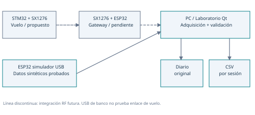
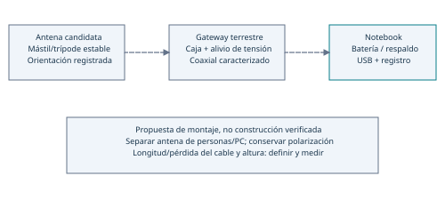

# Entrega técnica de groundstation y cámaras para PDR

17/11/2026 - v1. Rebe integra el PDR; esta entrega aporta diseño, evidencia y pendientes.

## 1. Estado de la entrega

Preparé este aporte de groundstation y cámaras para que Rebe redacte el PDR. Reúne arquitectura, resultados, alternativas, fuentes y verificación. Es una consolidación documental del 17/11/2026: no ejecuté nuevos ensayos físicos ni aprobé el contrato de vuelo.

El software de banco y la evidencia USB están disponibles para describir. La interfaz de vuelo, radio, energía y cámaras en misión conservan decisiones conjuntas y ensayos abiertos. Una propuesta documentada permite explicar el diseño preliminar; no equivale a demostrar cumplimiento.

Antes de incorporar un resultado hay que conservar su versión y alcance. El ensayo prolongado antecede al Laboratorio Qt; no atribuyo sus dos horas a la versión actual. Los informes diarios y respaldos no son ensayos técnicos nuevos.

| Bloque | Material preparado | Condición de cierre |
|---|---|---|
| Tierra / software | Arquitectura, funciones y evidencia USB | Adaptar a la interfaz final; campo pendiente |
| Comunicaciones | Airtime, alternativas y fórmula de enlace | D01/D02/D07 y ensayo RF |
| Antenas | Dos patrones revisados y montaje propuesto | Unidad real, pérdidas y selección conjunta |
| Cámaras | Progreso de guardado y prueba breve | D05/D06, potencia y ensayo dual |
| Verificación | Matriz con evidencia y campaña pendiente | Revisar con requisitos / versión vigente |

## 2. Arquitectura y conexiones de tierra

La arquitectura de vuelo propuesta es STM32 + SX1276, enlace RF, SX1276 + ESP32 terrestre, USB y PC. La flecha RF es una integración pendiente. El camino ya probado utiliza un ESP32 que genera datos sintéticos por USB, sin radio.

En la PC separo recepción/encuadre, validación, modelo de datos, presentación y escritores por destino. Conservo originales y CSV por sesión. El segundo destino sólo cuenta como respaldo independiente si está en otro soporte y se verifica; dos carpetas del mismo disco comparten fallas.

No fijo GPIO SPI, IRQ, alimentación o adaptadores sin identificar la placa de radio y su revisión. El módulo informado por Edu es NiceRF LoRa1276-915/SX1276; la correspondencia con el pinout conserva una discrepancia documentada. USB del gateway, sensor de cámara y bus de vuelo son interfaces distintas.

| Componente | Interfaz prevista | Estado |
|---|---|---|
| ESP32 terrestre / PC | USB serie, fuente explícita | Banco probado; receptor RF pendiente |
| SX1276 / ESP32 | SPI + control/IRQ, alimentación según módulo | Pines, variante y desacoplo por confirmar |
| Antena / radio | 50 ohm; coaxial/conector del equipo real | Ganancias/pérdidas no fijadas |
| PC / soportes | Diario y CSV, errores por escritor | Ensayos previos E01/E02; simultáneo externo pendiente |

## 3. Software y evidencia de banco

El Laboratorio Qt presenta 22 campos y once gráficos para quince canales numéricos. Permite fuentes explícitas USB, simulación PC y reproducción; abre sin mediciones. Una desconexión conserva histórico y edad, sin iniciar simulación como sustituto. Los gráficos no unen huecos ni dibujan un GPS sin solución [E03].

En el ensayo prolongado recibí y guardé 7261 paquetes sintéticos en 7260.328 segundos monotónicos. El intervalo medio observado fue 1.000045 s, con extremos 0.937 y 1.063 s. El CSV reconstruido coincide por SHA-256 con el adquirido; el segmento nominal cerró sin descartes o errores de escritores [E01].

La campaña incluyó una misión inicial y permanencia posterior en LANDED: demuestra duración del flujo de banco, no vuelo, autonomía o sensores. Los cortes USB, identidades y huecos tienen campañas y revisiones separadas [E02].

Para una demostración se puede usar reproducción del CSV conservado, mostrando claramente su origen histórico. Las órdenes permanecen deshabilitadas en reproducción. Una demostración nueva debe registrar fuente, versión, resultado y límites; no la presento como ya grabada.

| Evidencia | Resultado útil para el PDR | Límite |
|---|---|---|
| E01 | 7261 filas; reconstrucción coincidente | USB / valores sintéticos / revisión anterior |
| E02 | Reconexión y hueco de 18 muestras observable | No conservación garantizada ante corte eléctrico |
| E03 | 22 campos y 11 gráficos integrados | Validación Qt offscreen; sol pendiente |
| Órdenes de banco | Cero, hora y alimentación ficticias | No ejecución física STM32 por RF |

## 4. Paquete, tiempo de aire y enlace

Edu define bytes y comandos de vuelo; adapto tierra a esa versión [E08]. Los 22 campos ASCII son el perfil de banco; unos 55 bytes son una estimación, no un layout aprobado. El tamaño de aplicación debe incluir sus cabeceras, identidad, destino, versión, validez y controles acordados.

Recalculé nueve hipótesis con la herramienta existente: LoRa, BW 125 kHz, CR 4/5, preámbulo 8, encabezado explícito y CRC físico. El CRC y encabezado de radio están incluidos por la fórmula; órdenes, respuestas, cambios TX/RX y guardas se presupuestan aparte [E06/M04].

Propongo comparar SF7 como candidato temporal inicial y SF9/SF10 como alternativas según el margen del mismo perfil, sin configurarlos ni aprobarlos. SF10 con 100 bytes supera un segundo antes de órdenes. Mayor SF puede mejorar sensibilidad y aumentar ocupación; sólo una campaña permite evaluar confiabilidad.

El margen real permanece desconocido: Prx = Ptx + Gtx + Grx - pérdidas - FSPL; margen = Prx - sensibilidad del perfil. A 915 MHz y 1 km oblicuo, FSPL = 91.676205 dB. No uso esta distancia como trayectoria confirmada ni sensibilidad extrema de otro SF para cerrar la cuenta [E07]. La potencia y régimen requieren revisión del módulo; no asumo +20 dBm continuo.

| Payload de aplicación | SF7 | SF9 | SF10 |
|---|---|---|---|
| 55 B (hipótesis) | 107.776 ms | 349.184 ms | 657.408 ms |
| 100 B (hipótesis) | 174.336 ms | 553.984 ms | 1026.048 ms |
| 255 B (hipótesis) | 399.616 ms | 1250.304 ms | 2295.808 ms |

## 5. Antenas y montaje propuesto

Actualizo la comparación del 23/10: ahora pude inspeccionar visualmente patrones oficiales de dos candidatas. Son alternativas de tierra, no componentes adquiridos o seleccionados. Mantengo Digi A09-Y11NF como alternativa direccional secundaria con patrón exacto pendiente; no reutilizo como oficial una curva de otro equipo.

En OMB revisé la p.8: hay diferencias entre cortes y mínimos, no cobertura esférica. En TI.92 revisé pp.8-9, recta y articulada: la orientación modifica el patrón. No extraigo de las curvas una ganancia mínima garantizada sobre la trayectoria ni copio sus imágenes sin permiso.

Como propuesta de portabilidad priorizaría evaluar el dipolo compacto TI.92; la OMB permite comparar otra distribución angular pero exige soporte mayor. La elección final necesita perfil, recorrido, pérdidas y disponibilidad. Propongo mástil/trípode estable, radio protegida y alivio de tensión; coaxial corto y caracterizado, sin fijar altura o longitud como requisitos [D07].

| Candidata | Dato de fabricante | Patrón / restricción |
|---|---|---|
| Taoglas TI.92.2113 | 902-928 MHz; SMA macho; 198 mm; 22.5 g | Ficha A: pico 1.21 dBi recta / 2.14 articulada. Web dice máximo 2.9: discrepancia, no adoptar sin aclarar [M02]. |
| Taoglas OMB.915.B05F21 | 902-928 MHz; N hembra; pico 5.9 dBi | 1094 +/-30 mm; antena 500 g + soporte 70 g. Patrón oficial p.8 inspeccionado [M01]. |
| Digi A09-Y11NF | Yagi 900 MHz; 11.1 dBi; N hembra | Apuntado y patrón exacto del modelo por confirmar. No dar alcance por ganancia pico [M03]. |

## 6. Cámaras: arquitectura y operación

La propuesta mantiene dos ESP32-CAM/OV2640, cenit y nadir, cada una con SD, alimentadas por el sistema de potencia. El objetivo es que el computador de vuelo inicie y supervise la grabación sin depender de la notebook. El circuito y los pines de control no quedan aprobados por este documento.

Propongo la secuencia: espera, alimentación/arranque, foto + escritura/lectura de chequeo, armado, inicio con margen antes del descenso requerido, grabación autónoma, cierre y recuperación. El evento y margen de inicio deben acordarse con vuelo; cero de altura no inicia automáticamente video. Apagar Wi-Fi no equivale a apagar sensor o cortar consumo.

Para reportar progreso necesito por unidad identidad/arranque, ejecución/segmento, cuadros y bytes guardados, última escritura, espacio y error. Un inicio aceptado, una foto o un LED no confirman continuidad. Si vence el reporte, tierra muestra desconocido. Si sólo hay START discreta falta resolver un canal de retorno [D05/D06].

Ambas unidades produjeron JPEG VGA RGB y guardaron/leyeron con lector externo en un ensayo por turnos, usando una sola SD [E04]. Después cámara 1 grabó 123 cuadros en 29.828024 s entre extremos: 4.090113 fps y hueco máximo 0.479809 s. La copia USB se verificó y el MP4 se creó en PC, sin inventar cuadros [E05].

La cámara siguió mientras cerré seguimiento USB ocho segundos, conservando alimentación USB: no demuestra batería o supervivencia al reset del OBC. Falta grabación dual, energía, arranque sin botones, SD llena/lenta y recuperación ante corte. Wi-Fi es mantenimiento local; sonido queda fuera de esta etapa. No hay prueba nueva en este paquete.

## 7. Verificación y riesgos que quedan abiertos

Dejo una campaña ordenada para cerrar integración. Los criterios cuantitativos que dependen de misión, enlace o energía se acuerdan antes de probar. Los veinte ciclos de arranque son una propuesta de banco, no una certificación estadística. Una prueba pasada de una revisión no se hereda automáticamente a otra.

Esta tabla alimenta la matriz de requisitos: no sustituye la matriz vigente de Rebe ni declara cumplimiento por tener un documento. El cierre de cada ensayo conserva versión, configuración, procedimiento, registros y evidencia de resultado.

| ID / objeto | Ensayo y aceptación propuestos | Estado |
|---|---|---|
| V01 / Trama y unidades | Comparar bytes y valores; rechazar inválidos sin actuación | Pendiente ICD / ensayo conjunto |
| V02 / Órdenes | Separar aceptación/ejecución; no repetir actuación por timeout | Banco probado; vuelo pendiente |
| V03 / RF a 1 Hz | Medir recepción única, ráfagas, RTT y presupuesto temporal; umbrales a acordar | Pendiente hardware/perfil |
| V04 / Enlace y antenas | Comparar modelos con mismas condiciones y margen objetivo acordado | Pendiente campaña RF |
| V05 / Registro y respaldo | Conteos/huellas, recuperación y errores de cada destino; no rellenar huecos | USB prolongado previo; respaldo físico simultáneo pendiente |
| V06 / Dos cámaras | Duración que cubra misión y margen acordados; cuadros/tiempos/errores; lectura externa | Cámara 1 breve probada; conjunto pendiente |
| V07 / Arranque y reset | Propuesta: 20 ciclos por unidad y registrar primer guardado, fallos y archivos; cantidad no certifica fiabilidad | Pendiente circuito y ensayo |
| V08 / Energía y SD | Medir tensión/corriente/picos y archivos recuperables; criterios EPS/tiempo a acordar | Pendiente banco físico |

## 8. Texto técnico para incorporar al PDR

Ground segment architecture. We propose an STM32/SX1276 flight node, an SX1276/ESP32 ground gateway and a USB-connected PC. RF integration is pending. The implemented USB bench uses an ESP32-generated synthetic telemetry source. Acquisition, parsing, data quality, presentation and storage are separated; retained values are marked historical after a link interruption.

Implemented software and evidence. The native Qt laboratory integrates 22 telemetry fields and 11 plots. A previous USB bench revision received and stored 7,261 synthetic packets over 7,260.328 seconds; offline reconstruction produced an identical CSV hash. This demonstrates that bench configuration, not flight sensors, RF performance, battery autonomy or a two-hour validation of the current Qt application.

Communications design. The final payload and command encoding are defined by flight software and adapted on the ground side. A 55-byte payload is an estimate. Under BW125 kHz, CR4/5, eight preamble symbols, explicit header and PHY CRC, calculated airtimes are 107.776 ms at SF7, 349.184 ms at SF9 and 657.408 ms at SF10. Commands and guard times require additional allocation. The real link margin remains TBD until profile-specific sensitivity, antennas, losses and geometry are fixed.

Camera payload. We propose two autonomous ESP32-CAM units with independent microSD storage. Both units produced independently readable VGA colour photographs in sequential bench tests. Camera 1 subsequently recorded 123 frames with a measured first-to-last interval of 29.828024 s and a mean rate of 4.090113 fps. Recording continued when USB monitoring was closed while USB power remained connected. Dual-camera operation, flight power, startup without manual intervention and OBC-reset tolerance remain to be verified.

Verification status. Existing results are labelled as calculations, software tests, physical USB tests or camera bench tests. Flight ICD approval, RF interoperability, antenna/mount selection, power measurements and complete-mission dual recording remain open. Each proposed test has explicit configuration and acceptance evidence; no missing measurement is replaced by an assumed zero.

## 9. Definiciones necesarias y acceso a evidencia

Estas decisiones no están escondidas en el texto para Rebe. La tabla editable decisiones_para_Edu.csv conserva las preguntas, coordinación y efecto sobre el cierre. Edu puede contestar con una versión preliminar y ejemplos, distinguiendo implementado, propuesto y pendiente. El mensaje separado está preparado para copiar; no fue enviado.

D01 paquete; D02 radio; D03 telecomandos; D04 estados/reinicios; D05 control y potencia de cámaras; D06 reportes de guardado; D07 hardware y geometría. Con esos datos completo el contrato terrestre y las cuentas. Hasta entonces los campos compartidos siguen TBD/TBR.

Referencias E01-E09: evidencia propia conservada. M01-M04: fabricantes. N01: cobertura oficial parcial. Las fuentes enlazadas mantienen su fecha; no afirmo haber revalidado todo el aula o todos los PDF hoy. El formato final de entrega y vencimiento concreto requieren comprobación en la actividad oficial.

## Fuentes enlazadas

- [E01 - USB prolongado y CSV](https://github.com/edulandoni/astra-cansat/blob/193e58c2297c41b5c7d973ab515bc36df86f5060/ground-station/docs/2026-10-24-aceptacion-banco-usb-actualizacion-09.md)
- [E02 - Cortes y reconexión USB](https://github.com/edulandoni/astra-cansat/blob/193e58c2297c41b5c7d973ab515bc36df86f5060/ground-station/docs/2026-10-25-interfaz-y-cortes-usb.md)
- [E03 - Laboratorio Qt completo](https://github.com/edulandoni/astra-cansat/blob/193e58c2297c41b5c7d973ab515bc36df86f5060/ground-station/docs/historial/2026-10-26-laboratorio-completo-04.md)
- [E04 - Fotos de ambas unidades y lector](https://github.com/edulandoni/astra-cansat/blob/193e58c2297c41b5c7d973ab515bc36df86f5060/ground-station/docs/camaras/2026-10-26-ambas-camaras-sd-y-lector-07.md)
- [E05 - Grabación segmentada y supervisión](https://github.com/edulandoni/astra-cansat/blob/193e58c2297c41b5c7d973ab515bc36df86f5060/ground-station/docs/camaras/2026-10-27-grabacion-segmentada-y-supervision-usb.md)
- [E06 - Payload y perfil LoRa](https://github.com/edulandoni/astra-cansat/blob/193e58c2297c41b5c7d973ab515bc36df86f5060/ground-station/docs/interfaces/2026-10-26-payload-sf-confiabilidad-04.md)
- [E07 - Presupuesto de enlace y entradas pendientes](https://github.com/edulandoni/astra-cansat/blob/193e58c2297c41b5c7d973ab515bc36df86f5060/ground-station/docs/interfaces/2026-10-24-enlace-destinos-y-revision.md)
- [E08 - Comandos definidos desde vuelo](https://github.com/edulandoni/astra-cansat/blob/193e58c2297c41b5c7d973ab515bc36df86f5060/ground-station/docs/interfaces/2026-10-25-comandos-definidos-desde-vuelo.md)
- [E09 - Vista Wi-Fi confirmada](https://github.com/edulandoni/astra-cansat/blob/193e58c2297c41b5c7d973ab515bc36df86f5060/ground-station/docs/camaras/2026-10-27-vista-wifi-confirmada-y-red-compartida.md)
- [M01 - Taoglas OMB.915.B05F21, rev. A, pp.4 y 8](https://www.taoglas.com/datasheets/OMB.915.B05F21.pdf)
- [M02 - Taoglas TI.92.2113, rev. A, pp.4 y 8-9](https://www.taoglas.com/datasheets/TI.92.2113.pdf)
- [M03 - Digi A09-Y11NF](https://www.digi.com/products/models/antennas/a09-y11nf)
- [M04 - Semtech SX1276, rev.7, pp.31 y 84](https://cdn.sparkfun.com/assets/7/7/3/2/2/SX1276_Datasheet.pdf)
- [N01 - Corte oficial PARCIAL del 17/11](https://github.com/edulandoni/astra-cansat/blob/193e58c2297c41b5c7d973ab515bc36df86f5060/ground-station/docs/aula/2026-11-17/Informe_aula_2026-11-17_0047_ART.md)
