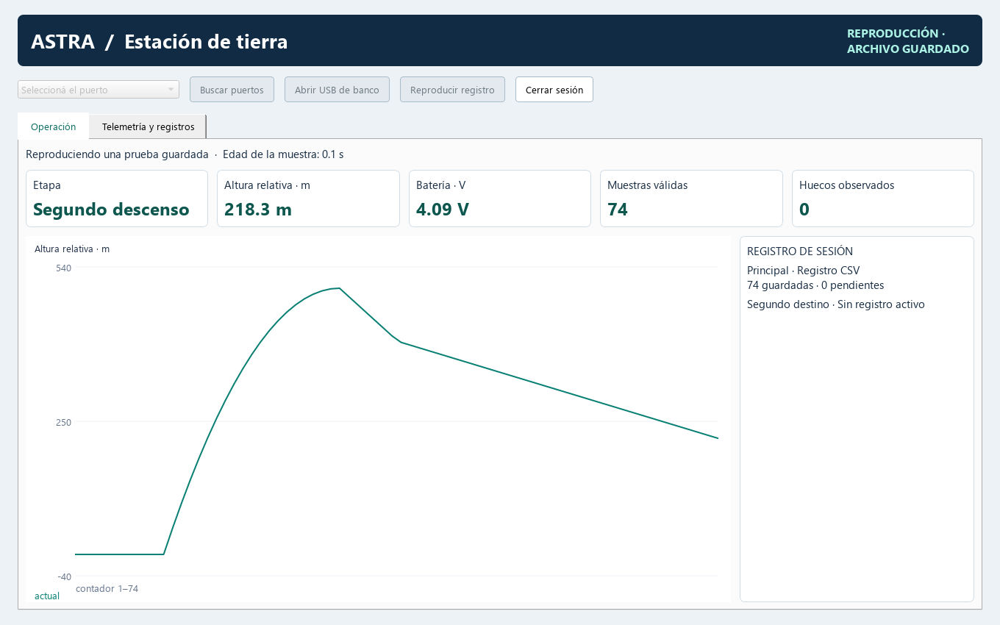

# ASTRA-22 · Operator console and PDR evidence

Run `python station.py` from ground-station using the PySide6 and pyserial environment documented in [Laboratorio](../../../laboratorio/README.md). Choose a recorded JSONL journal or explicitly select the USB bench device. Session archives default to `ASTRA-Station` in the home directory. Select a second destination from Telemetry and Records → Guardado before opening a session.

| Decision | Alternative and trade-off | Evidence and acceptance |
| --- | --- | --- |
| Dedicated operator console using the existing Qt acquisition and recording engine | The full laboratory groups many experiments. The dedicated view puts source, sample age, mission state and storage together. Reusing the engine avoids maintaining two decoders. | Offscreen session with the archived bench replay showed telemetry and kept commands disabled. Next, test an operator's ability to recognize stale data and a failed writer at nominal viewing distance in daylight. |
| Keep the source journal and derived CSV | CSV alone is easy to share but loses original frames and rejection provenance. A second directory by itself does not establish media independence. | Physical USB bench recovered a byte-identical CSV from 7,261 synthetic packets. Repeat with the agreed RF path and independent storage. Disconnect one destination and compare retained data, error indications and recovery. |
| Retain gaps and make the source explicit | Connecting missing samples makes trajectories easier to read but can imply data that were never received. Automatically substituting simulation would make the display misleading. | Qt uses discontinuous series at sequence breaks. Test loss, reset and reconnection with the final flight identities and sequence semantics. |

The screenshot shows the actual Qt application replaying archived USB bench traffic with synthetic measurements. The standalone console shares the bench protocol. Flight RF interoperability and operational acceptance remain pending.

References: [PWr Aerospace 2024, pp. 102–103](https://www.cansatcompetition.com/docs/teams/Cansat2024_2044_pdr_v02.pdf#page=102), [UCI AntSat 2024, pp. 136–140](https://www.cansatcompetition.com/docs/teams/cansat2024_2057_pdr_v01.pdf#page=136), [USB bench evidence](../../2026-10-24-aceptacion-banco-usb-actualizacion-09.md).

[Editable PDR v5](https://docs.google.com/presentation/d/1Gkh1IhS2pTmvO6wJA7G2sAOENlEq1R3K_q6-J3EI-Gk/edit). The presentation master remains in Drive because it includes third-party reference figures. The console, original screenshot, slide text and integration map are versioned here.
